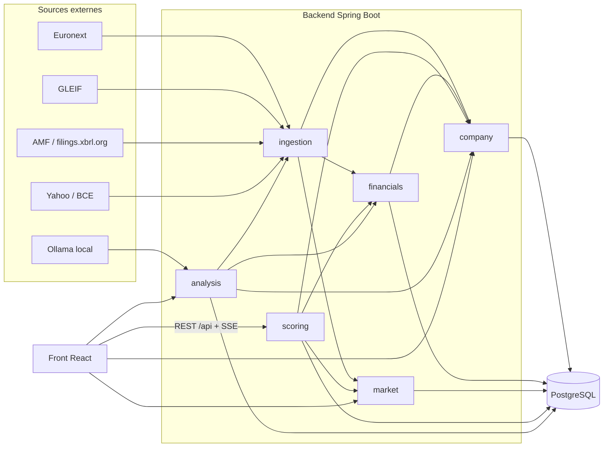

# Analyse Parts

Analyse Parts note de 0 à 100 les sociétés cotées à Euronext Paris selon quatre profils
d'investisseur (Qualité, Croissance, Dividende, Value) et explique chaque note ratio par ratio.
Les chiffres viennent des rapports annuels officiels (format ESEF, déposés à l'AMF). Un modèle
de langage local lit aussi les rapports pour résumer l'activité, les avantages et les risques ;
cette lecture est affichée à côté de la note et n'entre jamais dans son calcul.

Démo en ligne : <https://analyse-parts.onrender.com/> (offre gratuite : le premier affichage peut
prendre une minute si le serveur dormait).

- [Lancer l'application](#lancer-lapplication)
  - [Avec Docker (recommandé)](#avec-docker-recommandé)
  - [Sans Docker](#sans-docker)
  - [Remplir la base](#remplir-la-base)
- [Architecture](#architecture)
  - [Où trouver quoi](#où-trouver-quoi)
- [Tests](#tests)
- [Configuration](#configuration)
- [Documentation](#documentation)

## Lancer l'application

| Outil | Version | Sert à |
|---|---|---|
| JDK | 27 | le backend (le wrapper Maven `mvnw` est fourni, inutile d'installer Maven) |
| Node.js | 24 | le front React |
| PostgreSQL | 17 ou plus | la base ; fourni par Docker, ou installé à la main |
| Docker Desktop | récent | facultatif : la base en conteneur, l'image de production, les tests d'intégration |
| Ollama | récent | facultatif : la lecture des rapports par le modèle local (voir [plus bas](#lecture-des-rapports-par-le-llm-facultatif)) |

L'application tourne sur deux ports en développement : le backend Spring Boot sur
`http://localhost:8080` (API sous `/api`) et le front Vite sur `http://localhost:5173`, qui relaie
`/api` vers le backend.

### Avec Docker (recommandé)

**Option 1 : développement, la base seule dans Docker.** Spring Boot lit `backend/compose.yaml` et
démarre lui-même un PostgreSQL 17 (base, utilisateur et mot de passe `analyseparts`, port **5433**
pour ne pas gêner un PostgreSQL déjà installé sur 5432). Le conteneur reste allumé après l'arrêt de
l'application, et les données sont gardées dans le volume `pgdata`.

```bash
# terminal 1 : le backend (Docker Desktop doit être lancé)
cd backend
./mvnw spring-boot:run          # Windows : mvnw.cmd spring-boot:run

# terminal 2 : le front
cd frontend
npm install
npm run dev                     # http://localhost:5173
```

Au premier démarrage, Flyway crée les tables (`backend/src/main/resources/db/migration`).
La base est vide : voir [Remplir la base](#remplir-la-base).

**Option 2 : l'image de production, comme sur Render.** Un seul conteneur sert l'API et le site
compilé (ADR 0016). La construction compile le front, le backend, puis prépare le cache AOT de Java
(démarrage en 19 s au lieu de 2 min sur un petit serveur) : comptez quelques minutes.

```bash
docker build -t analyse-parts .

# avec la base de l'option 1 (déjà démarrée) :
docker run --rm -p 8080:8080 \
  -e DATABASE_URL=jdbc:postgresql://host.docker.internal:5433/analyseparts \
  -e DATABASE_USER=analyseparts -e DATABASE_PASSWORD=analyseparts \
  -e ADMIN_TOKEN=un-secret \
  analyse-parts
# site et API sur http://localhost:8080
```

L'image démarre avec le profil `prod` (`application-prod.properties`) : pas de Docker Compose, pas
de LLM, et chaque route `/api/admin/**` demande l'en-tête `X-Admin-Token: un-secret`.

### Sans Docker

Il faut un PostgreSQL 17 ou plus installé sur la machine. Créez la base une fois :

```sql
create user analyseparts password 'analyseparts';
create database analyseparts owner analyseparts;
```

Puis désactivez Docker Compose et donnez l'adresse de la base par variables d'environnement
(Spring les lit à la place de `application.properties`) :

```bash
cd backend
export SPRING_DOCKER_COMPOSE_ENABLED=false
export SPRING_DATASOURCE_URL=jdbc:postgresql://localhost:5432/analyseparts
export SPRING_DATASOURCE_USERNAME=analyseparts
export SPRING_DATASOURCE_PASSWORD=analyseparts
./mvnw spring-boot:run
```

Sous Windows PowerShell, remplacez `export NOM=valeur` par `$env:NOM = "valeur"`, et `./mvnw` par
`.\mvnw.cmd`. Le front se lance comme avec Docker (`npm install`, puis `npm run dev`).

Pour un seul exécutable, sans Maven au lancement :

```bash
cd frontend && npm run build && cd ..
cp -r frontend/dist/. backend/src/main/resources/static/   # le site servi par Spring à la racine
cd backend && ./mvnw -DskipTests package
java -jar target/backend-*.jar   # avec les mêmes variables d'environnement ; tout sur :8080
```

Le dossier `static/` ainsi rempli est une copie de build, ignorée par Git.

### Remplir la base

Les données viennent de sources publiques et gratuites ; chaque collecte se lance par une route
d'administration. Dans l'ordre, pour une base vide :

```bash
API=http://localhost:8080/api/admin
curl -X POST "$API/ingestion/euronext?mic=XPAR"         # ~330 sociétés de Paris ; les LEI (GLEIF) suivent seuls
curl -X POST "$API/ingestion/factsheets"                # secteur ICB et nombre d'actions (fiches Euronext)
curl -X POST "$API/ingestion/esef?limit=400"            # rapports annuels ESEF (AMF, puis filings.xbrl.org) : long
curl -X POST "$API/ingestion/prices"                    # derniers cours (Yahoo)
curl -X POST "$API/ingestion/price-history?full=true"   # 5 ans de cours
curl -X POST "$API/scoring/calibrate"                   # barèmes par secteur, à partir des sociétés notées
```

Ajoutez `-H "X-Admin-Token: …"` quand `ADMIN_TOKEN` est défini (profil `prod`). Ensuite, des tâches
planifiées tiennent tout à jour : cours chaque minute en séance, historique et change le soir,
fiches Euronext la nuit, nouveaux rapports AMF chaque matin.

Plus rapide : restaurer une copie de base existante (`pg_dump -Fc`, puis `pg_restore`), comme pour
la démo en ligne.

### Lecture des rapports par le LLM (facultatif)

La lecture des rapports annuels et semestriels utilise [Ollama](https://ollama.com) sur
`http://localhost:11434`. Sans Ollama, le reste de l'application fonctionne ; les lectures échouent
simplement. Pour l'activer :

```bash
ollama pull qwen3:14b    # le modèle qui lit (12 Go de mémoire graphique conseillés)
ollama pull bge-m3       # le modèle d'embeddings qui choisit les passages à lire
curl -X POST http://localhost:8080/api/admin/analysis/FR0000120321   # lire un rapport (ici L'Oréal)
curl -X POST http://localhost:8080/api/admin/analysis/missing        # lire tous ceux qui manquent
```

Pour qu'un nouveau rapport ne déclenche pas de lecture automatique, mettez
`ANALYSEPARTS_ANALYSIS_AUTO=false`.

## Architecture

Un seul backend Spring Boot découpé en modules (monolithe modulaire, ADR 0001), un front React, une
base PostgreSQL. [Spring Modulith](https://spring.io/projects/spring-modulith) vérifie à chaque build
(`ModularityTests`) qu'aucun module n'utilise ce qu'un autre garde pour lui.



Une flèche d'un module vers un autre veut dire « utilise ». `company` ne dépend de personne ;
`ingestion` est le seul module qui parle aux sources externes, sauf la lecture par LLM.

| Module | Rôle | Dossier |
|---|---|---|
| `company` | les sociétés : ISIN, LEI, nom, secteur ICB, place de cotation | `backend/src/main/java/com/analyseparts/company` |
| `ingestion` | fait entrer les données externes, un sous-dossier par source (`euronext`, `gleif`, `esef`, `prices`) ; surveille l'état de chaque source | `…/ingestion` |
| `financials` | stocke les faits bruts des rapports ESEF et en tire les indicateurs annuels (chiffre d'affaires, résultat, dette…) | `…/financials` |
| `market` | derniers cours, historique des cours, taux de change ; pousse les cours au navigateur en direct (SSE) | `…/market` |
| `scoring` | ratios, barèmes, profils et notes ; le calcul est en Java pur dans `scoring/core` (ni Spring ni base) | `…/scoring` |
| `analysis` | lecture des rapports annuels et semestriels par le LLM local ; citations vérifiées | `…/analysis` |

Dans chaque module, le dossier racine est son API publique (services, contrôleurs REST,
événements) ; le sous-dossier `internal` (accès à la base, détails) n'est visible que du module.
Les modules se parlent aussi par événements : `CompaniesImported` lance la recherche des LEI,
`FilingRecorded` recalcule l'historique des notes et met le rapport en file de lecture.

À la racine de `com.analyseparts` : `BackendApplication` (démarrage), `AdminTokenFilter` (jeton des
routes admin) et `SpaForwardController` (renvoie les adresses du site React vers `index.html`).

### Où trouver quoi

| Vous cherchez… | Regardez |
|---|---|
| comment une note est calculée | `scoring/core/ScoreCalculator.java`, puis [ADR 0003](docs/adr/0003-methode-de-score.md) |
| la liste des ratios, leurs formules et barèmes | `scoring/core/Ratio.java`, `RatioCalculator.java`, et [docs/ratios.md](docs/ratios.md) |
| les poids de chaque profil | `scoring/core/Profile.java` |
| les barèmes adaptés au secteur | `scoring/core/SectorCalibration.java`, [ADR 0004](docs/adr/0004-baremes-par-secteur.md) |
| quel concept XBRL donne quel indicateur | `financials/Metric.java` (concepts candidats, dans l'ordre), `MetricExtractor.java` |
| le téléchargement des rapports ESEF | `ingestion/esef/` : `AmfFilingsClient`, `FilingsXbrlClient`, `EsefImportService` |
| la lecture d'un rapport XBRL | `ingestion/esef/InlineXbrlParser.java` (paquet AMF), `XbrlJsonParser.java` (filings.xbrl.org) |
| les cours de bourse | `ingestion/prices/` (Yahoo, BCE) et `market/` (stockage, SSE) |
| la lecture d'un rapport par le LLM | `analysis/internal/ReportAnalyst.java` (consignes, lots, doublons), `PassageSearch.java` (embeddings), `Quotes.java` (vérification des citations) |
| les rapports semestriels et les 12 mois glissants | `analysis/internal/HalfYearReader.java`, `HalfYearChecks.java`, [ADR 0015](docs/adr/0015-rapports-semestriels-et-12-mois-glissants.md) |
| les routes de l'API | les classes `*Controller.java` de chaque module |
| les tâches planifiées | `@Scheduled` dans `ingestion/` (collectes), `scoring/ScoreHistoryService.java` (notes du soir) |
| le schéma de la base | `backend/src/main/resources/db/migration/V*.sql` (Flyway ; ne jamais modifier une migration déjà appliquée) |
| la configuration | `backend/src/main/resources/application.properties` (dev), `application-prod.properties` (démo) |
| les pages du site | `frontend/src/pages/` ; appels à l'API dans `frontend/src/api/`, graphiques dans `frontend/src/charts/` |
| les définitions affichées aux débutants | `frontend/src/glossary.ts` (bulles d'aide `<Term>` et page `/lexique`) |
| pourquoi une décision a été prise | [docs/adr](docs/adr/README.md) : une décision par fichier |

Les chemins Java sont relatifs à `backend/src/main/java/com/analyseparts/`. Les noms de méthodes
commencent par un verbe (`computeRoe`, `findLatestFiling`, `parseIcb`) ; seuls les accesseurs des
records Java (`isin()`, `periodEnd()`) et les fabriques `of(...)` gardent la convention du langage.

## Tests

```bash
cd backend
./mvnw verify     # tous les tests, dont ModularityTests (frontières des modules) ; environ 1 min
cd ../frontend
npm run build     # vérifie les types TypeScript
npm run lint
```

Les tests d'intégration démarrent un PostgreSQL jetable avec Testcontainers : sans Docker, ils
échouent, les tests unitaires passent quand même. Les appels aux sources externes sont simulés.

## Configuration

| Variable d'environnement | Défaut | Rôle |
|---|---|---|
| `SPRING_DOCKER_COMPOSE_ENABLED` | `true` | `false` pour utiliser une base installée à la main |
| `SPRING_DATASOURCE_URL`, `_USERNAME`, `_PASSWORD` | via Docker Compose | adresse de la base en développement |
| `DATABASE_URL`, `DATABASE_USER`, `DATABASE_PASSWORD` | aucun | adresse de la base avec le profil `prod` |
| `ADMIN_TOKEN` | vide (routes admin ouvertes) | jeton demandé par `/api/admin/**` |
| `SPRING_PROFILES_ACTIVE` | aucun (`prod` dans l'image Docker) | profil de configuration |
| `OLLAMA_URL` | `http://localhost:11434` | adresse d'Ollama |
| `ANALYSIS_MODEL` | `qwen3:14b` | modèle qui lit les rapports |
| `ANALYSIS_CONTEXT_TOKENS` | `10240` | mémoire du modèle ; au-delà, il déborde de 12 Go de mémoire graphique |
| `ANALYSIS_REVIEW` | `BUSINESS,ADVANTAGES` | thèmes relus par le modèle |
| `ANALYSEPARTS_ANALYSIS_AUTO` | `true` (`false` en `prod`) | lire chaque nouveau rapport automatiquement |

## Documentation

- [docs/adr](docs/adr/README.md) : les décisions d'architecture, de 0001 (monolithe modulaire) à
  0016 (démo gratuite).
- [docs/ratios.md](docs/ratios.md) : chaque ratio expliqué, avec sa formule et sa lecture.
- [frontend/README.md](frontend/README.md) : l'organisation du front.
